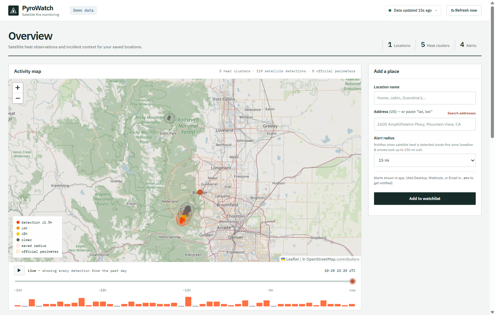

# PyroWatch

[](https://github.com/shaurya202/pyrowatch/actions/workflows/ci.yml)
[](LICENSE)

Local, self-hosted satellite wildfire & thermal-anomaly monitor built with **FastAPI**, **SQLite**, and a dependency-free **Leaflet** web console.



PyroWatch continuously watches places you care about—your home, family addresses, cabins, or campuses—by combining near-real-time satellite heat observations with official incident perimeters, surface weather, and local smoke readings:

1. **NASA FIRMS VIIRS NRT** — polls Suomi NPP, NOAA-20, and NOAA-21 (~375 m thermal anomalies) or runs in zero-key **Demo Mode** out of the box.
2. **Spatial-temporal clustering** — groups repeated satellite overpasses into distinct heat clusters instead of spamming per pixel.
3. **NIFC WFIGS enrichment** — matches clusters against official US wildfire incidents, acreage, containment %, and active perimeters.
4. **NWS & EPA AirNow context** — pulls National Weather Service gridpoint wind/humidity (downwind alignment) and nearby PM2.5 AQI.
5. **Explainable 0–100 context score** — ranks relevance per `(location, cluster)` pair with transparent reasons and explicit *limited data* flags when feeds are unavailable.
6. **Smart alerts** — notifies on `new_group` inside your watch radius, `new_satellite` confirmation, and `score_increase` (with cooldown), delivered in-app plus optional **Webhook / Slack**, **SMTP Email**, or **Windows Desktop Toast**.

> **Important disclaimer:** A satellite detection is a *thermal anomaly* (which can include prescribed burns, agricultural fires, or industrial heat), not a confirmed wildfire. Scores are an informational context index only—never an official warning or evacuation tool. Coverage for NWS, WFIGS, AirNow, and Census geocoding is **US-focused** (manual `lat, lon` coordinates are also supported).

---

## Quick Start

**Prerequisites:** Python 3.10+

### macOS / Linux
```bash
git clone https://github.com/shaurya202/pyrowatch.git
cd pyrowatch
python3 -m venv .venv && source .venv/bin/activate
pip install -r requirements.txt
cp .env.example .env      # Optional: add free NASA FIRMS / EPA AirNow keys
python -m pyrowatch       # Opens at http://127.0.0.1:8000
```

### Windows (PowerShell)
```powershell
git clone https://github.com/shaurya202/pyrowatch.git
cd pyrowatch
python -m venv .venv; .\.venv\Scripts\Activate.ps1
pip install -r requirements.txt
copy .env.example .env    # Optional: add free NASA FIRMS / EPA AirNow keys
python -m pyrowatch       # Opens at http://127.0.0.1:8000
```

*(Or install as an editable package with `pip install -e .` to get the `pyrowatch` CLI command.)*

**Zero-config Demo Mode:** With no `FIRMS_MAP_KEY` set (`DEMO_MODE=auto`), PyroWatch seeds a sample watchlist location and two synthetic fire clusters near Boulder, CO so you can explore the live map, 24-hour replay scrubber, scoring breakdown, and alert feed immediately.

### Docker
```bash
docker build -t pyrowatch .
docker run --rm -p 8000:8000 -v pyrowatch-data:/app/data --env-file .env.example pyrowatch
```

---

## Web Console Highlights

* **Activity Map & 24h Replay** — saved locations with alert radii, active detection clusters, age-colored satellite passes, official WFIGS fire perimeters, and an interactive 24-hour timeline scrubber + histogram.
* **Watchlist Cards** — per-location 0–100 activity context score, plain-language contributing factors, inside- vs. outside-radius cluster breakdown, AQI chip, and 24-hour score sparkline.
* **Address Search & Coordinates** — US address typeahead (OpenStreetMap Nominatim + US Census Geocoder fallback) or direct `lat, lon` entry.
* **Source Freshness Popover** — live health and last-sync timestamps for NASA FIRMS, NWS Weather, EPA AirNow, and NIFC WFIGS, plus on-demand **Refresh now**.

---

## Configuration

All settings are read from `.env` in the project root (or environment variables). See [`.env.example`](.env.example) for full documentation.

| Variable | Default | Description |
|---|---|---|
| `FIRMS_MAP_KEY` | *(empty)* | Free key from [NASA FIRMS](https://firms.modaps.eosdis.nasa.gov/api/map_key/); empty uses demo data when `DEMO_MODE=auto` |
| `AIRNOW_API_KEY` | *(empty)* | Free key from [EPA AirNow](https://docs.airnowapi.org/); optional |
| `DEMO_MODE` | `auto` | `auto` (demo when no FIRMS key), `force` (always demo), or `off` |
| `FIRMS_FEEDS` | `VIIRS_SNPP_NRT,VIIRS_NOAA20_NRT,VIIRS_NOAA21_NRT` | Comma-separated VIIRS NRT feeds |
| `FIRMS_DAY_RANGE` | `2` | Lookback window (`1`–`5` days) |
| `POLL_INTERVAL_MINUTES` | `10` | Background polling interval (minimum `2`) |
| `DB_PATH` | `data/pyrowatch.db` | SQLite database path (WAL mode) |
| `HOST` / `PORT` | `127.0.0.1` / `8000` | HTTP server bind address and port |

### Outbound Notifications (Optional)

| Channel | Configuration | Notes |
|---|---|---|
| **Webhook / Slack** | `ALERT_WEBHOOK_URL=https://...` | `POST`s JSON alert batches; set `ALERT_WEBHOOK_FORMAT=slack` for Slack Block Kit |
| **Email (SMTP)** | `SMTP_HOST=...` + `ALERT_EMAIL_TO=a@x.com` | Supports STARTTLS (`SMTP_Port=587`, `SMTP_TLS=true`) or SSL (`SMTP_SSL=true`, port `465`) |
| **Windows Toast** | `ALERT_DESKTOP=true` | Enabled by default on Windows (`false` on macOS/Linux); sends one native WinRT toast per cycle |

Tune alert sensitivity with `ALERT_SCORE_DELTA` (default `15`) and `ALERT_SCORE_COOLDOWN_MIN` (default `240`).

> **Deployment note:** PyroWatch is designed as a **single-user local/self-hosted app** bound to `127.0.0.1` with no built-in user authentication. Do not expose it directly to the public internet without placing it behind an authenticated reverse proxy or tunnel.

---

## JSON API

| Method | Endpoint | Purpose |
|---|---|---|
| `GET` | `/api/health` (`/health`) | Liveness probe |
| `GET` | `/api/meta` | Active configuration, delivery channels, and feed freshness |
| `GET` | `/api/dashboard` | Full UI payload (locations, clusters, detections, perimeters, alerts) |
| `GET` | `/api/geocode/suggest?q=...` | US address & coordinate autocomplete suggestions |
| `GET` | `/api/locations` | List watched locations |
| `POST` | `/api/locations` | Add a watched location (`name`, `address` or `lat`/`lon`, `radius_miles`) |
| `POST` | `/api/locations/{id}` | Update a watched location |
| `DELETE` | `/api/locations/{id}` | Delete a watched location and its history |
| `GET` | `/api/history/{id}` | 24-hour score & distance series for one location |
| `GET` | `/api/alerts?limit=100` | Recent alerts |
| `POST` | `/api/refresh` | Trigger an immediate pipeline cycle |

---

## Development & Tests

```bash
pip install -r requirements.txt -r requirements-dev.txt ruff
python -m ruff check .
python -m pytest tests -q
```

The test suite runs **100% offline** using isolated temporary SQLite databases and stubbed upstream responses.

---

## License

Released under the [MIT License](LICENSE).
